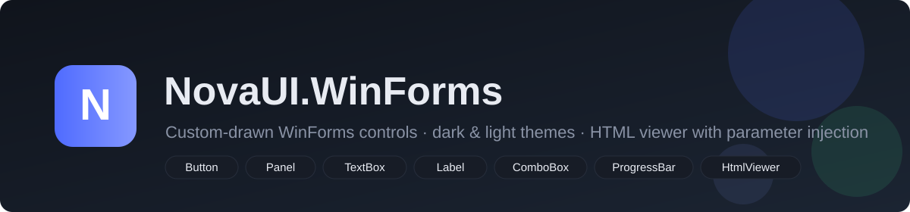

# NovaUI.WinForms

A clean-room, custom-drawn WinForms control suite. Every control paints itself with
GDI+ (rounded corners, hover/focus states, dark & light themes) - no third-party
dependencies, one DLL, works on **.NET Framework 4.7.2** and **.NET 8.0 (Windows)**.

## Controls

| Control | What it does |
| --- | --- |
| [NovaButton](controls/nova-button.md) | Rounded button, `Filled` / `Outline` styles, per-control accent |
| [NovaPanel](controls/nova-panel.md) | Rounded card container with border |
| [NovaTextBox](controls/nova-textbox.md) | Single-line rounded textbox with placeholder |
| [NovaLabel](controls/nova-label.md) | Label with optional accent dot |
| [NovaComboBox](controls/nova-combobox.md) | Owner-drawn dropdown with popup list |
| [NovaProgressBar](controls/nova-progressbar.md) | Progress bar with determinate and marquee modes |
| [NovaHtmlViewer](controls/nova-html-viewer.md) | HTML viewer (WebBrowser engine) with custom links, print support and **template parameter injection** |

## Highlights

- **One shared theme engine** - call `NovaTheme.ApplyDark()` / `NovaTheme.ApplyLight()` and
  every live control repaints instantly.
- **HTML parameter injection** - put `{{PatientName}}` in any HTML file and fill it at
  runtime: `viewer.Parameters["PatientName"] = "Juan"; viewer.LoadFile("form.html");`
- **Multi-target** - ships as `net472` and `net8.0-windows` from one code base (C# 7.3).
- **C# and VB.NET everywhere** - every page shows both languages.

## Start here

1. [Getting started](getting-started.md) - reference the DLL, build a first window
2. [Theming](theming.md) - dark mode in one line
3. [NovaHtmlViewer](controls/nova-html-viewer.md) - printable HTML forms with parameters

## Verified builds

| Target | Result |
| --- | --- |
| net472 | 0 errors / 0 warnings - TFM `.NETFramework,Version=v4.7.2` |
| net8.0-windows | 0 errors / 0 warnings - TFM `.NETCoreApp,Version=v8.0` |

Verified with `tools/analyze_guna.py` (dnfile metadata inspection): 17 types,
243 methods, 72 properties per target. Pre-built DLLs live in
`NovaUI.WinForms/dist/net472/` and `NovaUI.WinForms/dist/net8.0-windows/`.

> [!TIP]
> New to GitBook? See [the publishing guide](gitbook-publishing.md) for how this
> documentation is structured and how to publish your own copy.
